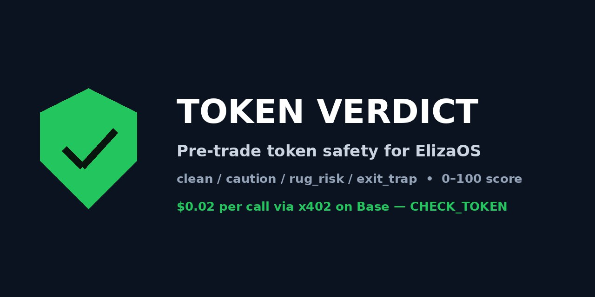

# @thewinnerscircle/plugin-token-verdict

Token Verdict for ElizaOS — a pre-trade Base token safety check, paid per call via x402.



## What it does

One action, **CHECK_TOKEN**: when a Base token contract address appears and a buy / swap / recommendation is being considered, the agent calls Token Verdict *before* trading and replies with the verdict card.

```
POST https://crypto-intel-agent.vercel.app/api/token-verdict
Body: { "address": "0x<token contract>", "chain": "base" }
Price: $0.02/call, USDC on Base via x402 — no API key
```

Returns: `verdict` (`clean` / `caution` / `rug_risk` / `exit_trap`), a 0–100 `score`, `reasons`, and cited `facts` (liquidity, top-holder concentration, honeypot / mint / tax flags, from DexScreener/GeckoTerminal + GoPlus). Scoring is deterministic. A failed check (HTTP 502, sources could not produce a verdict) is **never charged**.

## Gate rule

```
clean     → proceed
caution   → warn / trade small or skip
rug_risk  → DO NOT TRADE
exit_trap → DO NOT TRADE
```

## Install

```bash
elizaos plugins add @thewinnerscircle/plugin-token-verdict
# or: npm install @thewinnerscircle/plugin-token-verdict
```

Add to your character:

```json
{ "plugins": ["@thewinnerscircle/plugin-token-verdict"] }
```

## Configuration

| Setting | Required | Notes |
|---|---|---|
| `EVM_PRIVATE_KEY` | yes | Wallet holding a small, capped USDC float on Base. Each check pays exactly $0.02 via `@x402/fetch` (exact scheme, CDP facilitator — gas-free for the payer). Cap the float: that is your spend limit. |

## Example

> User: Should I buy 0x833589fCD6eDb6E08f4c7C32D4f71b54bdA02913?
> Agent: Checking it before any trade — Token Verdict: clean, 88/100. Liquidity is deep across multiple Base pools; no honeypot or punitive sell tax found.

## Discovery

Endpoint is cataloged in the Coinbase x402 Bazaar; also listed on Agent402 and agent-tools.cloud (#3249). `/.well-known/x402`, OpenAPI and an A2A card are published at https://crypto-intel-agent.vercel.app

## License

MIT
